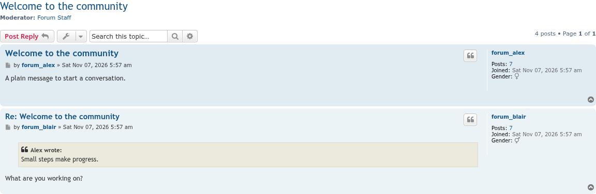
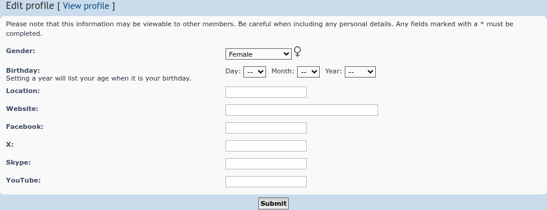
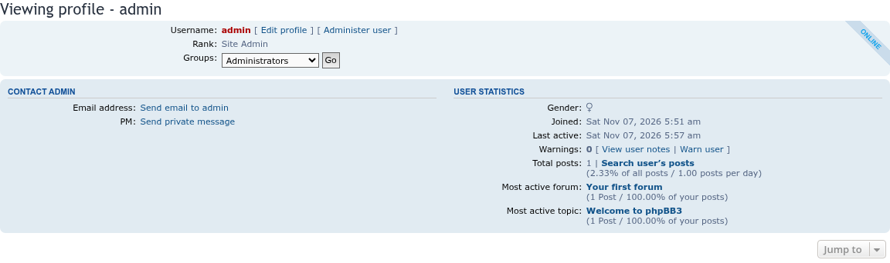
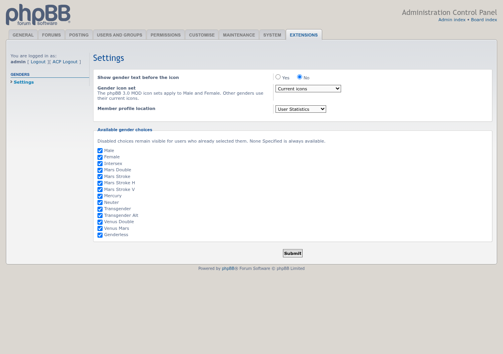

# Genders

 

Lets members choose a gender, shown as an icon in posts, profiles and search results.

## Features

- Members pick a gender when they register and in the UCP profile; administrators can change it in **ACP → Users**. A preview shows the icon as you choose.
- The gender icon appears next to posts, in search results and on member profiles.
- Settings under **ACP → Extensions → Genders → Settings**:
  - show the gender name before the icon;
  - choose an icon set: the current Font Awesome icons, or one of eight sets from the phpBB 3.0 Genders MOD;
  - show gender in User Statistics or in the main profile details;
  - choose which genders members can pick.
- Translations can give members wording that matches their gender, for languages where sentences change with it. See [Gender-specific language strings](https://github.com/phpbbmodders/genders/wiki/Gender-specific-language-strings) on the wiki.

## Screenshots

<table>
<tr>
<td></td>
<td></td>
</tr>
<tr>
<td></td>
<td></td>
</tr>
</table>

Click an image for the full size. See the [screenshot gallery](docs/images/screenshots/README.md) for captions.

## Requirements

- phpBB 3.3.19 or later, including phpBB 4.0 (tested on its 4.0.0-a3 development version)
- PHP 8.3.36 or later

## Installation

1. Copy the extension to `/ext/phpbbmodders/genders`
2. In the Administration Control Panel, go to **Customise → Manage extensions**
3. Enable the **Genders** extension
4. Choose the settings under **ACP → Extensions → Genders → Settings**

### Upgrading from `rmcgirr83/genders`

This extension used to be installed as `rmcgirr83/genders`. Members' genders carry over:

1. Disable the old **Genders** extension in the ACP. Do **not** delete its data.
2. Upload this version to `/ext/phpbbmodders/genders` and enable it. The old install's migration history is moved to the new name automatically.
3. Delete the `/ext/rmcgirr83/genders` folder and purge the board cache.

If you disable the old extension from the command line (`bin/phpbbcli.php`) instead of the ACP, run `bin/phpbbcli.php cache:purge` before enabling the new one; the command-line disable doesn't clear the cache.

## Genders settings

The icon set selector includes the original prosilver and subsilver2 sets, the
(fe)male-images, mini, minigender and planetary sets, and both prosilver
alternates from [Genders 1.0.2 for phpBB 3.0](https://www.phpbb.com/customise/db/mod/genders/)
by Kailey and bonelifer (GPL-2.0). These sets supply Male and Female icons.
Other genders use the current icons.

All choices are available by default. When a choice is disabled, members who
already selected it keep it and can still switch to an available choice. None
Specified is always available.

## TODO

Ideas not yet built, practical and speculative alike: [`docs/TODO.md`](docs/TODO.md).

## Contributing

Contributions are welcome!

- **Bug reports**: [Open an issue](https://github.com/phpbbmodders/genders/issues).
- **Everything else** (questions, feature requests, ideas, general discussion): [Use Discussions](https://github.com/orgs/phpbbmodders/discussions), or the [community forum](https://www.phpbbmodders.com/community/).
- Pull requests are welcome for bug fixes or discussed features.

## Acknowledgments

- Extension by Rich McGirr ([RMcGirr83](https://github.com/rmcgirr83)), based on the phpBB 3.0 Genders MOD by phpBBmodders.net.
- Code review, bug fixes, and documentation assisted by [Claude](https://www.anthropic.com/claude).
- Gender settings and icon sets assisted by [Codex](https://openai.com/codex/).

## License

This extension is licensed under the **GNU General Public License v2.0**.

See [license.txt](license.txt) for more information.
