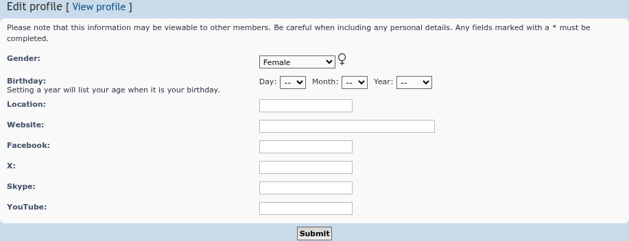
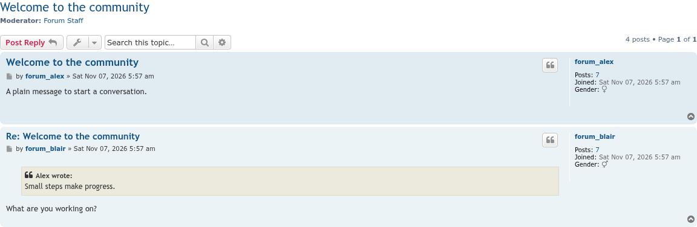
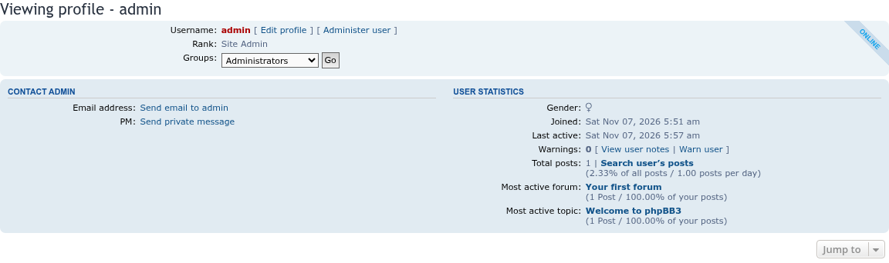
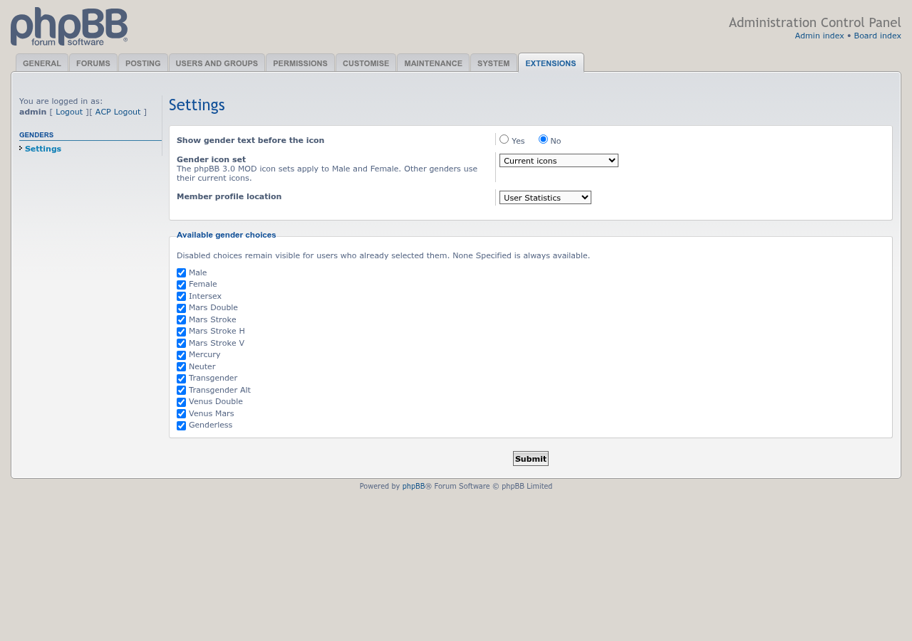

# Genders screenshots

All screenshots use the default settings: icon only, shown in User Statistics.

## UCP profile

Members choose a gender in **UCP → Profile → Edit profile**, at registration, and administrators can change it in **ACP → Users → Profile**. The icon next to the list shows the choice.

## Posts

The gender icon in each post's author profile.

## Member profile

## ACP settings

**ACP → Extensions → Genders → Settings**: gender text before the icon, icon set, profile location and the available choices.

