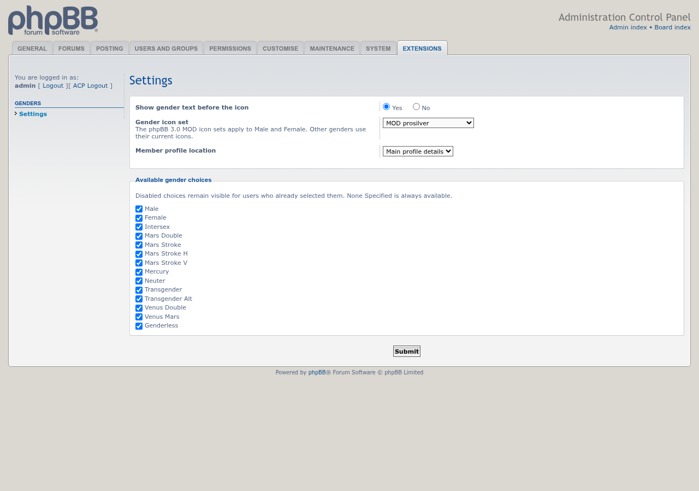
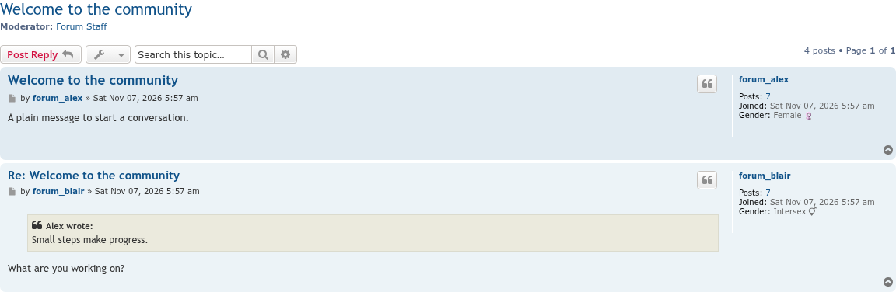
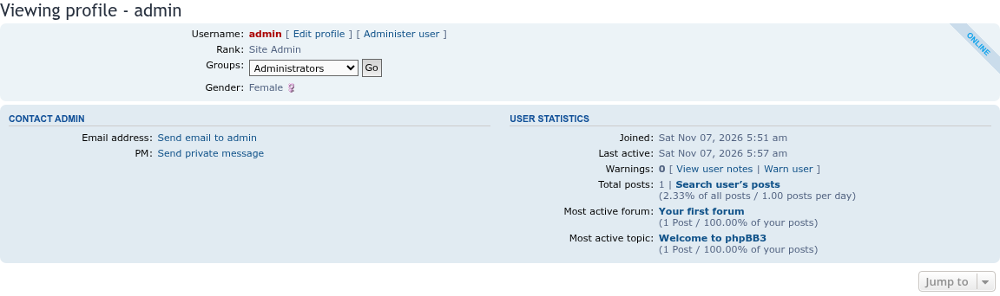

# Genders update screenshots — 11/06/2026

The new settings page, **ACP → Extensions → Genders → Settings**, with gender text turned on, the phpBB 3.0 MOD prosilver icon set chosen and gender moved to the main profile details. Every gender can be offered or left out under **Available gender choices**.

A topic with **Show gender text before the icon** on. Female uses the MOD prosilver icon; Intersex has no MOD icon and keeps its current one.

A member profile with gender shown in the main profile details instead of User Statistics.

